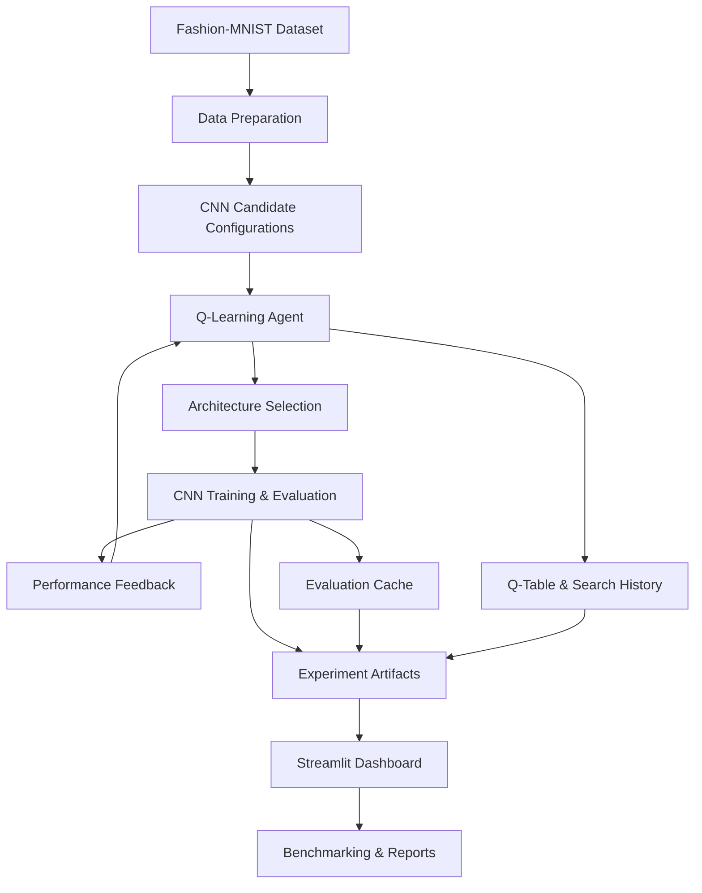

# AutoNAS-RL
[🚀 Live Demo](https://autonas-rl-7tvlsar4vaspsgkdhmn4kz.streamlit.app/) |
[📂 GitHub Repository](https://github.com/Pranav123221/AutoNAS-RL)
### Reinforcement Learning-Based Neural Architecture Search for Hardware-Aware CNN Optimization

<p align="center">
  <strong>Learning to design efficient neural networks through Reinforcement Learning.</strong>
</p>

<p align="center">
  
  
  
  
  
</p>

---

## Overview

**AutoNAS-RL** is a Reinforcement Learning-based Neural Architecture Search (NAS) project that explores CNN architecture configurations using a Q-Learning agent.

Traditional CNN development often relies on manually selecting architectural hyperparameters and repeatedly experimenting with different configurations. AutoNAS-RL investigates an alternative approach: formulating architecture selection as a sequential decision-making problem.

The agent explores candidate CNN configurations, receives feedback from model evaluations, and updates its Q-values to guide subsequent architecture selection.

The project combines:

- Reinforcement Learning for architecture exploration.
- Convolutional Neural Networks for image classification.
- Model evaluation and performance benchmarking.
- Hardware-aware performance measurements.
- An interactive Streamlit dashboard for experiment analysis.

**Primary objective:** Investigate the trade-offs between predictive performance, model complexity, and computational efficiency when searching for CNN architectures.

## Key Features

- **Q-Learning-Based Architecture Search:** Uses a reinforcement learning agent to explore candidate CNN configurations.
- **CNN Evaluation Pipeline:** Trains and evaluates candidate architectures on the Fashion-MNIST dataset.
- **Architecture Benchmarking:** Compares an RL-searched CNN against a fixed CNN baseline.
- **Performance Evaluation:** Tracks accuracy, precision, recall, F1-score, parameter counts, and inference performance where available.
- **Experiment Persistence:** Stores search history, candidate configurations, evaluation results, and trained models.
- **Evaluation Caching:** Reuses previously evaluated configurations through an evaluation cache.
- **Interactive Dashboard:** Visualizes architecture search, benchmarking, hardware efficiency, and experiment reports.
- **Reproducible Artifacts:** Maintains model checkpoints, Q-table data, and experiment reports.

## System Architecture



## Reinforcement Learning Approach

AutoNAS-RL uses Q-Learning to guide the architecture search process.

The Q-Learning update rule is:

\[
Q(s,a) \leftarrow Q(s,a) +
\alpha \left[
r+\gamma\max_{a'}Q(s',a')-Q(s,a)
\right]
\]

Where:

- \(s\): Current search state.
- \(a\): Selected architecture-search action.
- \(r\): Reward received from evaluation.
- \(s'\): Next search state.
- \(\alpha\): Learning rate.
- \(\gamma\): Discount factor.

The search process follows these conceptual stages:

1. Initialize the search environment and candidate configurations.
2. Select an architecture-search action.
3. Construct and evaluate the selected CNN configuration.
4. Calculate the evaluation feedback.
5. Update the Q-table.
6. Continue exploration and exploitation.
7. Save search history and evaluation artifacts.
8. Select and evaluate the resulting architecture.

The objective is to study how reinforcement learning can guide CNN architecture exploration under multiple performance considerations.

## Experimental Results

The following results are from the current recorded Fashion-MNIST test evaluation.

| Metric | Fixed CNN | RL-Searched CNN |
|---|---:|---:|
| Accuracy | 92.57% | 91.42% |
| Precision (Macro) | 92.53% | 91.41% |
| Recall (Macro) | 92.57% | 91.42% |
| F1-score (Macro) | 92.51% | 91.33% |

### Result Interpretation

The fixed CNN currently achieves higher classification performance than the RL-searched CNN in this experiment.

This is an important distinction: architecture search does not automatically guarantee better predictive accuracy.

The project therefore evaluates architecture search as an optimization problem involving predictive performance and computational considerations, rather than treating accuracy as the only success criterion.

*Results are experiment-specific and may vary with configuration, training conditions, and hardware.*

## Technology Stack

| Category | Technologies |
|---|---|
| Language | Python |
| Deep Learning | TensorFlow, Keras |
| Reinforcement Learning | Q-Learning |
| Machine Learning | NumPy, SciPy, Scikit-learn |
| Data Processing | Pandas |
| Visualization | Matplotlib, Plotly |
| Dashboard | Streamlit |
| Dataset | Fashion-MNIST |
| Model Storage | Keras |
| Experiment Storage | JSON, CSV, Pickle, NumPy |

## Project Structure

```text
AutoNAS-RL/
│
├── app.py
│
├── pages/
│   ├── 1_Architecture_Search.py
│   ├── 2_Model_Benchmarking.py
│   ├── 3_Hardware_Efficiency.py
│   └── 5_Experiment_Reports.py
│
├── src/
│   ├── Data processing and model components
│   ├── Reinforcement learning components
│   └── Experiment and artifact services
│
├── data/
│
├── artifacts/
│   ├── candidate_configs.json
│   ├── candidate_results.csv
│   ├── evaluation_cache.pkl
│   ├── experiment_summary.json
│   ├── final_experiment_report.json
│   ├── fixed_cnn.keras
│   ├── q_table.npy
│   ├── rl_searched_cnn.keras
│   └── search_history.pkl
│
├── models/
├── experiments/
├── results/
├── assets/
│
├── test_artifacts.py
├── test_data.py
├── requirements.txt
└── README.md
```

## Getting Started

### Prerequisites

- Python 3.13
- Git
- pip
- Sufficient memory and computational resources for CNN training and evaluation

### 1. Clone the repository

```bash
git clone https://github.com/Pranav123221/AutoNAS-RL.git

cd AutoNAS-RL
```

### 2. Create a virtual environment

**Windows PowerShell:**

```powershell
py -3.13 -m venv .venv

.\.venv\Scripts\Activate.ps1
```

### 3. Install dependencies

```bash
python -m pip install --upgrade pip

pip install -r requirements.txt
```

### 4. Run the application

```bash
streamlit run app.py
```

The dashboard will be available at:

```text
http://localhost:8501
```

## Dashboard

The Streamlit application provides dedicated interfaces for:

| Module | Purpose |
|---|---|
| Architecture Search | Explore and inspect RL-based architecture search |
| Model Benchmarking | Compare fixed and RL-searched CNN performance |
| Hardware Efficiency | Examine model complexity and inference-related metrics |
| Experiment Reports | Review saved experiment results and artifacts |

*Dashboard screenshots and a public demo link will be added after deployment.*


### Dashboard Preview

#### Main Dashboard


#### Architecture Search


#### Model Benchmarking


## Testing

Run the available project validation scripts:

```bash
python test_data.py

python test_artifacts.py
```

These scripts help validate the data and experiment artifact components.

## Engineering Considerations

The project explores several practical challenges in automated neural architecture search:

- Balancing exploration and exploitation during architecture search.
- Evaluating multiple CNN configurations efficiently.
- Managing the computational cost of repeated model training.
- Persisting search states and evaluation results.
- Comparing predictive performance with model complexity.
- Making experimental results accessible through an interactive interface.

## Current Limitations

- The current search space is limited to predefined candidate configurations.
- The RL-searched model does not outperform the fixed CNN in the recorded test accuracy comparison.
- Search performance depends on the reward formulation and available candidate architectures.
- Hardware measurements can vary across execution environments.
- Further experiments are required to establish generalization across datasets and hardware platforms.

## Future Work

- Expand the CNN architecture search space.
- Investigate reward-function design and multi-objective optimization.
- Improve search efficiency through better evaluation strategies.
- Explore additional hardware-aware optimization objectives.
- Evaluate performance across additional datasets and hardware environments.
- Improve experiment reproducibility and deployment capabilities.

## Author

**Pranav Sharma**

B.Tech — Computer Science and Engineering (AI & ML)

- GitHub: [@Pranav123221](https://github.com/Pranav123221)
- LinkedIn: [Pranav Sharma](https://www.linkedin.com/in/pranav-sharma-333b67338/)

---

## Acknowledgements

Built as an independent engineering project to explore the intersection of Reinforcement Learning, Neural Architecture Search, and efficient deep learning systems.

---

**AutoNAS-RL — Exploring automated neural architecture optimization through Reinforcement Learning.**
